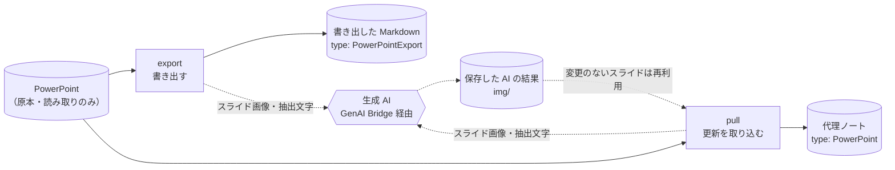

# Tkn PowerPoint Note — PowerPoint を Markdown ノートにする CLI

`tkn-powerpoint-note` は、PowerPoint のファイル（`.pptx` / `.pptm`）を、Frontmatter 付きの Markdown に変換するコマンドラインツールです。
スライドの文字・表・発表者ノートに加えて、図・矢印・配置・色で表した内容も、生成 AI でスライド画像から読み取り、文章で説明できます。
Obsidian などのノート、全文検索、RAG（検索結果を生成 AI の入力に使う仕組み）から PowerPoint の内容を参照しやすくすることが目的です。

初めて使う場合は、「[これは何か](#1-これは何か)」から「[1つの PowerPoint を Markdown にする](#3-1つの-powerpoint-を-markdown-にする)」までを順に読んでください。
フォルダの PowerPoint を継続的にノートにする場合は、続けて「[フォルダを継続的に取り込む](#4-フォルダを継続的に取り込む)」を読みます。
「[コマンド一覧](#5-コマンド一覧)」以降は、必要になったときに参照する内容です。

## 1. これは何か

### 1.1. 得られる結果の例

次は、構成図のあるスライドを、AI の説明付きで書き出した例です。
内容は架空の説明例で、Frontmatter と本文の一部を省略しています。

```shell
tkn-powerpoint-note export "C:\path\to\移行計画.pptx" --context --slides "2"
```

同じフォルダに `移行計画.pptx.md` が作成されます。

```markdown
---
type: PowerPointExport
schemaVersion: "1.0"
title: "移行計画"
author: Example User
sourceFileName: 移行計画.pptx
sourceFullPath: 'C:\path\to\移行計画.pptx'
sourceModified: "2026-09-30T18:20:00+09:00"
generationMethod: context
contextStatus: partial
contextAnalyzedSlides: "2"
---

# 移行計画

## Presentation Map

| Slide | ID | Title | Section | State | Text shapes | Pictures | Tables | Charts | Notes | Comments |
| ---: | --- | --- | --- | --- | ---: | ---: | ---: | ---: | --- | ---: |
| 1 | 256 | 移行計画 | — | visible | 2 | 0 | 0 | 0 | — | 0 |
| 2 | 257 | 移行後の構成 | 構成 | visible | 6 | 1 | 0 | 0 | yes | 0 |

## スライド

### スライド 2: 移行後の構成

#### スライドの説明（AI生成）

旧ファイルサーバーから新ストレージへ、中継サーバーを経由して複製する構成を示しています。
複製の検証に失敗した場合は、切り替えに進まず事前準備へ戻る矢印が描かれています。

##### 出典画像


#### Extracted Text

- 旧ファイルサーバー
- 中継サーバー（差分同期を2回実施）
- 新ストレージ
```

`--context` を付けない場合は、AI を使わずに「Presentation Map」（全スライドの一覧）と、スライドごとの「Extracted Text」（文字・表・グラフの値）、発表者ノート、コメントだけを書き出します。

### 1.2. 2つの使い方

| 使い方 | コマンド | 向いている用途 | 出力 |
| --- | --- | --- | --- |
| 書き出し | `export` | 1つの PowerPoint やフォルダを、その場で Markdown にする | 各ファイルの隣の `<ファイル名>.md`（`type: PowerPointExport`） |
| 取り込み | `pull` | 決まったフォルダの PowerPoint を、ノートとして継続的に管理する | ノート用フォルダの代理ノート（`type: PowerPoint`） |

どちらも、PowerPoint が原本です。
PowerPoint のファイルは読み取るだけで、変更しません。
Markdown の内容を PowerPoint へ書き戻す機能はありません。

### 1.3. 用語

| 用語 | 意味 |
| --- | --- |
| 代理ノート | `pull` で作成・更新する Markdown ノートです。1つの PowerPoint に1つのノートが対応します。 |
| source | 入力フォルダと代理ノートの保存先を組にした取り込み対象です。設定ファイルの `sources.<id>` に定義し、`--source <id>` で選びます。 |
| context | AI が生成するスライドごとの説明と、資料全体の要約です。`--context` を指定したときだけ生成します。 |
| generator | AI の接続先と文章の profile の組に名前を付けた設定です。`--generator <id>` で切り替えます。 |
| 文章の profile | context の構成・言語・見出しを決める、プロンプト・出力スキーマ・テンプレートの組です。既定は日本語の `default-ja` です。 |

### 1.4. 全体像

長方形は処理、円筒形はデータ、六角形は外部の AI サービスを表します。
破線は、`--context` を指定したときだけ使う経路です。



AI の呼び出しは、画像対応モデルへの接続を共通化するライブラリ [GenAI Bridge](https://github.com/tuckn/tkn_genai_bridge)（`tkn_genai_bridge`）を通して行います。
接続先・モデル・認証は、GenAI Bridge の共有設定ではなく、この CLI の設定ファイルの `genai_profiles` で管理します。

## 2. セットアップ

### 2.1. 前提

| 使う機能 | 必要なもの |
| --- | --- |
| AI を使わない書き出し・取り込み | Python 3.11 以降、[uv](https://docs.astral.sh/uv/) |
| `--context`（AI による説明の生成） | 上記に加えて、Windows、デスクトップ版 Microsoft PowerPoint、画像入力に対応する AI 接続先 |

`--context` 以外の処理は、PowerPoint のファイルを直接読み取るため、PowerPoint を起動しません。
動作確認は Windows で行っています。

### 2.2. インストール

ターミナルでリポジトリのフォルダへ移動し、CLI をインストールします。
依存ライブラリの GenAI Bridge は、インストール時に GitHub から取得します。

```shell
cd "C:\path\to\tkn_powerpoint_note"
uv tool install .
tkn-powerpoint-note --version
```

バージョン番号が表示されれば、インストールは完了です。
コマンドとオプションの一覧は `tkn-powerpoint-note --help`、各コマンドの詳細は `tkn-powerpoint-note export --help` のように確認できます。

### 2.3. AI 接続を準備する（`--context` を使う場合）

AI を使わない場合、この手順は不要です。

`--context` は、この CLI の `config.yaml` の `genai_profiles` に定義した接続先を使います。
既定の接続先 `codex-default` は、ログイン済みの Codex CLI を使います。
ほかの接続先やモデルを使う場合は、`tkn-powerpoint-note config init` で設定ファイルを作り、`genai_profiles` と `generation.generators` を書き換えます。
設定項目は「[設定リファレンス](docs/reference/configuration.md#ai-生成の設定)」を参照してください。

## 3. 1つの PowerPoint を Markdown にする

`export` は、設定ファイルを用意せずに使えます。
PowerPoint で編集中のファイルは、先に保存してから実行します。

### 3.1. 最初の書き出し

まず AI を使わずに書き出し、出力を確認します。

```shell
tkn-powerpoint-note export "C:\path\to\deck.pptx"
```

PowerPoint と同じフォルダに `deck.pptx.md` が作成されます。
完了すると、標準出力に1行ごとの `key=value` で結果が表示されます。
`status=success` と `exported=1` が表示されれば、書き出しは成功しています。

出力先を指定する場合は `--output` を使います。

```shell
tkn-powerpoint-note export "C:\path\to\deck.pptx" --output "C:\path\to\notes\deck.md"
```

非表示のスライドは、既定でノートに含めません（`--include-hidden` で含めます）。
完全にスライドの外にある要素も既定で除外し、`--off-slide append` で別の欄に含められます。

### 3.2. AI による説明を付ける

`--context` を付けると、スライドを画像にして AI で解析し、スライドごとの説明と資料の要約を Markdown に追加します。

> [!IMPORTANT]
> `--context` は、対象のスライドの画像・抽出した文字・発表者ノート・コメントを、設定した AI 接続先へ送信します。
> まだ説明のないスライドごとに1回と、資料の要約に1回、AI を呼び出します。接続先によっては費用や利用枠を消費します。
> 送信先と費用の扱いを確認してから実行してください。

最初は `--dry-run` で、呼び出しの回数（`plannedAiCalls`）を確認します。
`--dry-run` は PowerPoint の起動、AI の呼び出し、ファイルの保存を行いません。

```shell
tkn-powerpoint-note export "C:\path\to\deck.pptx" --context --slides "2-3" --dry-run
tkn-powerpoint-note export "C:\path\to\deck.pptx" --context --slides "2-3"
```

`--slides` と `--section` は、説明を付けるスライドを選びます。
スライド番号は、ファイル内の並び順を 1 から数えた位置で、範囲の両端を含みます。
セクション名は完全一致で、`--section` は繰り返し指定できます。
両方を指定すると、両方に当てはまるスライドを選びます。
番号とセクション名は `presentation list-slides` で確認できます。

```shell
tkn-powerpoint-note presentation list-slides --presentation "C:\path\to\deck.pptx"
```

1回の実行で AI に送るスライドは、既定で1資料あたり 10 枚までです。
超える場合は AI を呼ぶ前に止まり、対象を勝手に切り詰めません。
`--max-slides` で上限を変えるか、`--slides` で範囲を分けて実行します。
説明の済んだスライドは再利用するため、上限には数えません。

画像化には、デスクトップ版 PowerPoint を裏で起動します。
PowerPoint の一時コピーを開いて描画するため、元のファイルや作業中の PowerPoint は変更しません。
画像と AI の結果は、Markdown と同じフォルダの `img/<ファイル名>/` に保存されます。
Markdown を移動・共有するときは、`img/` も一緒に扱ってください。

生成した説明には AI の解釈が含まれます。
小さな文字や矢印の接続先は誤読される場合があるため、重要な箇所は元のスライドと見比べてください。

### 3.3. 書き出し直す・フォルダをまとめて書き出す

既存の Markdown は、既定では上書きしません。
同じ出力先に書き出し直す場合は `--force` を指定します。
`--context` を付けて書き出し直すと、内容の変わっていないスライドの説明は再利用します。

```shell
tkn-powerpoint-note export "C:\path\to\deck.pptx" --context --force
```

フォルダを指定すると、サブフォルダを含むすべての `.pptx` / `.pptm` を書き出します。
フォルダを指定した場合、`--output` は使えません。
一部のファイルで失敗しても、ほかのファイルの出力は保存し、失敗したファイルを結果の `results` に `export-error` として報告します。

## 4. フォルダを継続的に取り込む

取り込みでは、設定ファイルに登録した source ごとに、PowerPoint と代理ノートを対応付けて管理します。
`pull` は、実行したときに一度だけ処理します。
定期的に取り込む場合は、タスクスケジューラーなどから `pull` を実行します。

### 4.1. 設定ファイルを作る

```shell
tkn-powerpoint-note config init
```

`~/.tkn/powerpoint_note/config.yaml` が作成され、そのパスが結果の `configPath` に表示されます。
作成したファイルの `sources` を、自分の入力フォルダとノート保存先に書き換えます。
次の例では、source の ID を `library` にしています。

```yaml
sources:
  library:
    presentations:
      dir: 'C:\path\to\presentations'
      recursive: true
    notes:
      dir: 'C:\path\to\notes'
      frontmatter_term_format: plain
```

| 設定キー | 意味 |
| --- | --- |
| `presentations.dir` | 入力する PowerPoint のフォルダです。 |
| `presentations.recursive` | `true` でサブフォルダも対象にし、フォルダ構成をノート側にも再現します。 |
| `notes.dir` | 代理ノートを保存するフォルダです。Obsidian の Vault 内のフォルダを指定できます。 |
| `notes.frontmatter_term_format` | `plain` で `keywords` と `categories` を通常の文字列に、既定の `obsidian-link` で `[[...]]` のリンクにします。 |

編集後、読み込まれた設定を `tkn-powerpoint-note config list` で確認します。
ほかの設定キーと、設定ファイルの優先順位は「[設定リファレンス](docs/reference/configuration.md)」を参照してください。

### 4.2. 取り込む

`status` で作成・更新されるノートを確認してから、`pull` を実行します。
`status` はファイルを書き込みません。

```shell
tkn-powerpoint-note status --source library
tkn-powerpoint-note pull --source library
```

`notes.dir` に、PowerPoint ごとの代理ノート `<ファイル名>.md` が作成されます。
PowerPoint を保存した後に同じ `pull` を実行すると、変わったノートだけを更新します。
代理ノートの Frontmatter と本文の形式は「[ノートの形式](docs/reference/note-format.md)」を参照してください。

source 内の1ファイルだけを取り込む場合は、ファイル名を指定します。
登録済みのすべての source を取り込む場合は、`--all-sources` を使います。

```shell
tkn-powerpoint-note pull --source library "deck.pptx"
tkn-powerpoint-note pull --all-sources
```

### 4.3. AI の説明を付ける・更新する

`--context` を付けると、説明のないスライドと、内容の変わったスライドだけを AI で解析します。
送信する情報と呼び出し回数の考え方は「[AI による説明を付ける](#32-ai-による説明を付ける)」と同じです。

```shell
tkn-powerpoint-note pull --source library --context --dry-run
tkn-powerpoint-note pull --source library "deck.pptx" --context --slides "1-10"
```

スライドの挿入・並べ替え・削除や、内容を変えずに保存し直しただけでは、既存の説明を再利用します。
途中で失敗した場合は、同じコマンドを再実行すると、済んだスライドを再利用して残りから続けます。

`--context` を付けずに `pull` を実行すると、既存の説明はそのまま残します。
説明の生成後にスライドの内容が変わっていれば、Frontmatter の `contextStatus` を `stale` にし、そのスライドの説明の上に注意書きを付けます。

| `contextStatus` | 意味 |
| --- | --- |
| `not-generated` | 説明をまだ生成していません。 |
| `current` | ノートにあるすべてのスライドの説明が、保存済みの PowerPoint と対応しています。人が内容を確認したという意味ではありません。 |
| `partial` | 説明を生成していないスライドがあります。 |
| `stale` | 説明の生成後に内容が変わったスライドがあります。`--context` を付けて `pull` すると更新します。 |

しくみと上限の詳細は「[AI によるスライドの説明と資料の要約](docs/guides/slide-context.md)」を参照してください。

### 4.4. 手書きの部分と手直しの保護

代理ノートの本文のうち、ツールが管理する範囲は `<!-- powerpoint-note:begin -->` と `<!-- powerpoint-note:end -->` のマーカーで囲まれています。
マーカーの外に書いた文章と、ツールが知らない Frontmatter 項目は保持します。
`title`・`author` などの文書プロパティは、`pull` のたびに PowerPoint の値で更新します。

マーカーの中を手で直したノートは、`pull` で上書きせず、結果に `protected` として報告します。

> [!WARNING]
> `--force` は、手直しされたノートを `~/.tkn/powerpoint_note/state/backups/` に控えてから、マーカーの中を置き換えます。
> マーカーの外の文章は保持します。

`pull` は、PowerPoint と代理ノートを削除しません。
元の PowerPoint が見つからない代理ノートは、結果に `missing-source` として報告し、ノートはそのまま残します。
PowerPoint の名前を変えた場合は、新しい名前のノートを作り、前のノートを `missing-source` として報告します。

## 5. コマンド一覧

| 目的 | コマンド | 詳細 |
| --- | --- | --- |
| PowerPoint またはフォルダを Markdown に書き出す | `export <ファイルまたはフォルダ> [--context]` | [1つの PowerPoint を Markdown にする](#3-1つの-powerpoint-を-markdown-にする) |
| PowerPoint の更新を代理ノートへ取り込む | `pull (--source <id> または --all-sources) [<ファイル>] [--context]` | [取り込む](#42-取り込む) |
| 取り込みで変わるノートを確認する（変更なし） | `status --source <id>` | [取り込む](#42-取り込む) |
| スライドの番号・タイトル・セクションを一覧する | `presentation list-slides --presentation <パス>` | [AI による説明を付ける](#32-ai-による説明を付ける) |
| 設定ファイルを作成・確認する | `config init` / `config list` | [設定リファレンス](docs/reference/configuration.md) |

次のオプションは、どのコマンドでも、コマンドの前後のどちらにも指定できます。

| オプション | 動作 |
| --- | --- |
| `--config <パス>` | 指定した設定ファイルを、ほかの設定ファイルより優先して読み込みます。 |
| `--json` | 結果を1つの JSON で表示します。 |
| `-v` / `--verbose` | 診断情報をログに追加します。 |
| `-q` / `--quiet` | 情報ログを表示しません。 |
| `--no-color` | ログを色なしで表示します。 |

## 6. 実行結果の読み方

コマンドの結果は、標準出力に1行ごとの `key=value` で表示します。
入れ子のキーは `.`、配列の要素は `[0]` のような番号でつなぎます。
進捗・警告・診断は、常に標準エラーへ出力します。
`--json` を付けると、標準出力を1つの JSON に切り替えます。
端末・パイプ・リダイレクトのどれに出力しても、結果の形式は変わりません。

```shell
tkn-powerpoint-note pull --source library --dry-run
tkn-powerpoint-note --json pull --source library --dry-run
```

| 終了コード | 意味 |
| --- | --- |
| `0` | 成功しました。 |
| `1` | 一部またはすべての対象で、読み取り・生成・書き込みに失敗しました。手直しされたノートを保護した場合（`protected`）も含みます。 |
| `2` | コマンドの引数に誤りがあります。 |
| `3` | 設定ファイルや対象の指定に誤りがあります。 |
| `130` | 中断しました。完了したノートと、保存済みの AI の結果は残ります。 |

出力の項目と対象ごとの状態は「[CLI 出力契約](docs/reference/cli-output.md)」を参照してください。

## 7. 保存場所

| 保存場所 | 内容 | 失った場合の影響 |
| --- | --- | --- |
| `~/.tkn/powerpoint_note/config.yaml` | 設定ファイル | 入力フォルダと保存先の指定を作り直す必要があります。 |
| `notes.dir`（source ごと） | 代理ノート | 手書きの本文を失います。生成部分は `pull` で作り直せます。 |
| `notes.dir` の `img/<ファイル名>/` | スライドの画像、AI の結果、ノートの状態の記録（`state.json`） | 説明を再利用できなくなり、次の `--context` で生成し直します。手直しの有無は、ノートを作り直した内容と比べて確かめます。 |
| `~/.tkn/powerpoint_note/state/backups/` | `--force` で置き換える前のノート | 置き換え前の内容に戻せなくなります。 |

`export` は、Markdown を元ファイルの隣（または `--output`）に保存し、`--context` を付けたときだけ、その隣に `img/` を作ります。
ノートと `img/` には、元ファイルのパスや抽出した本文が含まれます。
公開するリポジトリなどに含めないよう注意してください。

## 8. 対応範囲と制限

- 入力は `.pptx` と `.pptm` です。旧形式の `.ppt`、暗号化されたファイル、Strict OOXML は読めません。PowerPoint で `.pptx` に保存し直してください。
- 保存済みの内容だけを読み取ります。PowerPoint で開いたまま保存していない編集は対象外です。
- `--context` の画像化は、マクロや ActiveX を含むファイルと、ハイパーリンク以外の外部参照（リンクした画像・動画・Excel のグラフなど）を含むファイルを拒否します。文字の抽出はできます。
- グラフは保存されている値を使います。リンク元のブックの最新の値とは違う場合があります。
- 画像の中の文字、動画、アニメーション、OLE オブジェクトの中身は抽出しません。マスターとレイアウトだけにある図は、画像には写りますが、文字としては抽出しません。
- 図形の位置から、作成者の意図した読む順は決められません。抽出した文字は、上から下、左から右の順に並べます。
- 文書プロパティとノートの Frontmatter の同期（`push`）、ファイルの名前変更の追跡、カード表示用の画像（`cover`）の作成は、実装していません。
- AI の説明は解釈を含みます。`contextStatus: current` は、説明と PowerPoint の対応を示すもので、内容の正確さを保証しません。

## 9. 更新

リポジトリを更新した後は、CLI を再インストールします。

```shell
cd "C:\path\to\tkn_powerpoint_note"
uv tool install . --reinstall
tkn-powerpoint-note --version
```

バージョンごとの変更内容と必要な対応は [CHANGELOG.md](CHANGELOG.md) を参照してください。

## 10. 開発と検証

```shell
uv sync --locked
uv run pytest
uv run ruff check .
uv run ruff format --check .
uv run mypy src
uv build
```

テストには小さな架空の PowerPoint と、AI・PowerPoint の代替処理を使い、個人の資料を外部へ送信しません。
Python パッケージ名は `powerpoint_note` です。
主な実装の入口は次のとおりです。

| ファイル | 担当 |
| --- | --- |
| [cli.py](src/powerpoint_note/cli.py) | コマンドと引数の定義、終了コード |
| [pipeline.py](src/powerpoint_note/pipeline.py) | `export` / `pull` の流れ、スライド単位の再利用の計画 |
| [extract.py](src/powerpoint_note/extract.py) | PowerPoint のファイルの読み取り |
| [evidence.py](src/powerpoint_note/evidence.py) | AI に送る根拠データと、再利用の鍵 |
| [context.py](src/powerpoint_note/context.py) | GenAI Bridge の呼び出しと記録 |
| [render.py](src/powerpoint_note/render.py) | PowerPoint によるスライドの画像化 |
| [markdown.py](src/powerpoint_note/markdown.py) | ノートの本文の組み立て |
| [context_profiles/](src/powerpoint_note/context_profiles/) | 文章の profile（プロンプト・出力スキーマ・テンプレート） |

## 11. 関連ドキュメント

| 文書 | 読む目的 |
| --- | --- |
| [AI によるスライドの説明と資料の要約](docs/guides/slide-context.md) | 説明の再利用のしくみ、上限、失敗したときの対処、独自の文章 profile の作成 |
| [設定リファレンス](docs/reference/configuration.md) | すべての設定キー、既定値、設定ファイルの優先順位 |
| [ノートの形式](docs/reference/note-format.md) | Frontmatter の項目、本文の構成、Presentation Map の各列の意味 |
| [CLI 出力契約](docs/reference/cli-output.md) | 結果の項目、対象ごとの状態、終了コード |
| [変更履歴](CHANGELOG.md) | バージョンごとの変更点 |
| [ライセンス](LICENSE) | 利用許諾 |
